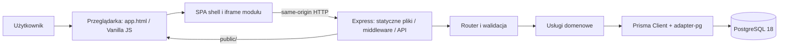
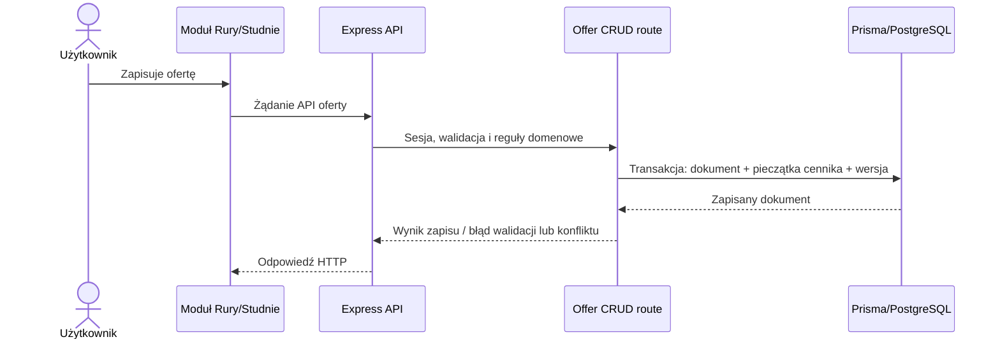
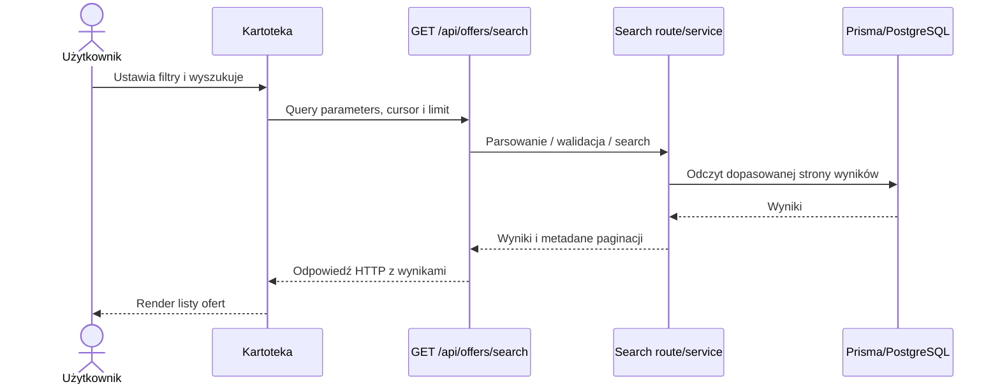
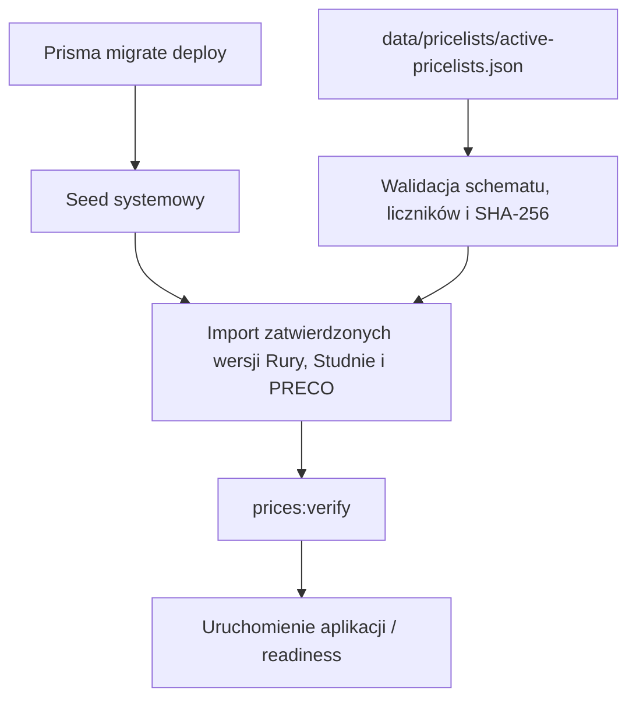
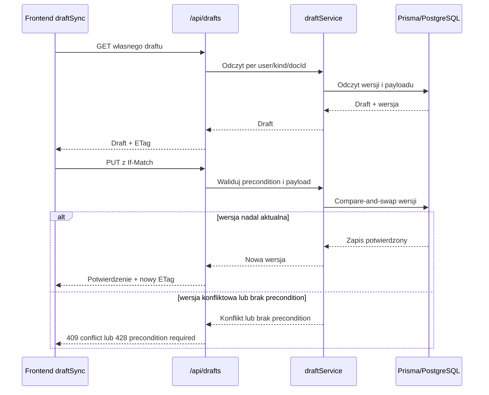
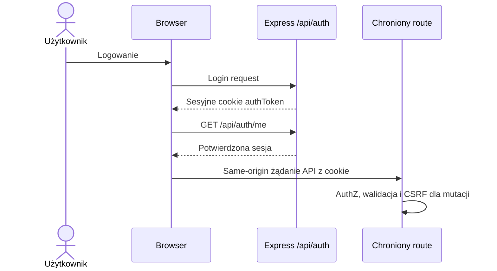
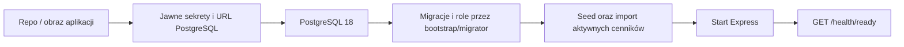

# S.O.K. — architektura i przepływy danych

- **Zweryfikowano:** 2026-11-06
- **HEAD:** `5ab15ac077d8eb94e66bcb08bac9d3c19d09f53f`
- **Zakres:** diagramy na poziomie warstw i potwierdzonych przepływów. Nie są specyfikacją payloadów ani zamiennikiem implementacji.
- **Legenda:** stan przepływu potwierdzony przez podane źródła; rozgałęzienia i szczegóły per feature należy czytać w kodzie.

## 1. Architektura ogólna

Źródła: [router SPA](../../public/js/spa/router.js), [Express app](../../src/app.ts), [montowanie tras](../../src/mountRoutes.ts), [Prisma client](../../src/prismaClient.ts), [schema](../../prisma/schema.prisma).

## 2. Zapis oferty

Dotyczy wyłącznie przebiegu zapisu potwierdzonego przez trasy CRUD: [Rury](../../src/routes/offers/ruryCrud.ts), [Studnie](../../src/routes/offers/studnieCrud.ts). Inwarianty: [snapshot ceny i wersjonowanie](../SYSTEM_INVARIANTS.md#L7-L14), [optimistic locking](../SYSTEM_INVARIANTS.md#L92-L100), [źródło cen](../SYSTEM_INVARIANTS.md#L161-L179). Konkretne kształty payloadów są w walidatorach i [API](../API.md).

## 3. Odczyt ofert w kartotece

Źródła: [UI wyszukiwania kartoteki](../../public/js/kartoteka/kartotekaSearch.js), [search route](../../src/routes/offers/search.ts), [wyszukiwanie API](../API.md#L243-L255). Wartości sortowania, filtry i paginacja zależą od walidacji route.

## 4. Wybór i import aktywnych cenników

Źródła kolejności instalacji: [pakiet cenników](../cutover/active-pricelists.md), [importer](../../scripts/import-active-pricelists.ts), [instalator Linux](../../install-linux-server.sh), [README](../../README.md). Pakiet świeżej instalacji zawiera jedną aktywną wersję każdego typu; nie odtwarza historycznych wersji, ofert ani klientów.

## 5. Synchronizacja draftu

Źródła: [draft service](../../src/services/drafts/draftService.ts), [draft routes](../../src/routes/drafts.ts), [frontend](../../public/js/shared/draftSync.js), [inwariant I-013](../SYSTEM_INVARIANTS.md#L134-L158). W konfliktowym scenariuszu lokalny draft nie może być po cichu utracony.

## 6. Uwierzytelnienie i żądanie chronione

Źródła: [frontend auth](../../public/js/shared/auth.js), [backend auth middleware](../../src/middleware/auth.ts), [CSRF](../../src/middleware/csrf.ts), [API registration](../../src/mountRoutes.ts). Szczegółowe role należą do konkretnego endpointu: [security](../SECURITY.md) i [macierz uprawnień](../security/permission-matrix.md).

## 7. Instalacja / wdrożenie i readiness

Źródła: [Compose](../../docker-compose.yml), [Dockerfile](../../Dockerfile), [bootstrap migracji](../../scripts/docker-db-bootstrap.sh), [wdrożenie](../DEPLOYMENT.md), [instalacja Linux](../../install-linux-server.sh). **UNKNOWN:** istnienie workflow skryptu nie potwierdza czystej instalacji na docelowym Linux ani produkcyjnego cutoveru.
