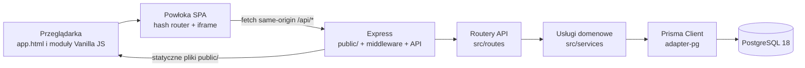

# S.O.K. — mapa runtime i modułów

## Metadane i wiarygodność

- **Status dokumentu:** opis potwierdzonego stanu kodu w zakresie wskazanych źródeł.
- **Klasyfikacja:** `FACT` oznacza fakt potwierdzony w kodzie/konfiguracji; `INFERENCE` oznacza wniosek z tych faktów; `UNKNOWN` oznacza informację, której ten dokument nie potwierdza.
- **HEAD zweryfikowany:** `5ab15ac077d8eb94e66bcb08bac9d3c19d09f53f`.
- **Dzień weryfikacji:** 2026-11-06.
- **Zakres:** rejestracja modułów SPA, montowanie API Express, granice uwierzytelniania i przepływ do bazy. Wskazane numery linii dotyczą powyższego HEAD.
- **Ograniczenie:** mapa API potwierdza prefiksy i przypisane routery, nie specyfikuje kontraktów payloadów ani pełnej macierzy uprawnień.

## Przepływ runtime

- **FACT:** `app.html` jest jedynym entry pointem SPA; aplikacja oparta jest na Vanilla JS i plikach statycznych serwowanych przez Express. Źródła: [frontend.md](../agents/frontend.md#L5-L9), [ADR-005](../adr/ADR-005-express-jedyny-serwer.md#L9-L21), [app.ts](../../src/app.ts#L344-L376).
- **FACT:** Express montuje routery API z `mountRoutes`; backend dokumentuje warstwy `routes → validators → services → Prisma`. Źródła: [mountRoutes.ts](../../src/mountRoutes.ts#L88-L157), [backend.md](../agents/backend.md#L9-L13).
- **FACT:** `prisma/schema.prisma` deklaruje provider `postgresql`; `src/prismaClient.ts` używa adaptera `@prisma/adapter-pg`; start aplikacji próbuje połączyć się z bazą przez Prisma i kończy inicjalizację błędem połączenia. Źródła: [schema.prisma](../../prisma/schema.prisma#L1-L12), [prismaClient.ts](../../src/prismaClient.ts#L1-L40), [app.ts](../../src/app.ts#L398-L410).
- **FACT:** `/api/*` jest warstwą komunikacji frontend–backend; frontend nie łączy się bezpośrednio z PostgreSQL. Źródło: [frontend.md](../agents/frontend.md#L7-L9).
- **INFERENCE:** logiczny przepływ zapisu/odczytu danych domenowych przebiega przez Express, router i warstwy backendu do PostgreSQL; diagram przedstawia warstwy opisane w repozytorium, a nie pełny graf wywołań każdej funkcji.
- **UNKNOWN:** ten diagram nie stanowi dowodu, że każdy istniejący moduł lub każdy endpoint używa identycznej sekwencji usług; szczegóły zależą od danego routera.

## Moduły SPA i iframe

Router parsuje hash w `public/js/spa/router.js:313-326`, a konfiguracja modułów znajduje się w `public/js/spa/router.js:256-310`. `getOrCreateIframe` tworzy iframe z identyfikatorem `spa-iframe-<module>` i ładuje wskazane źródło (`router.js:568-584`).

| Hash route    | Plik ładowany w iframe          | Potwierdzenie                                                                                                                                                            |
| ------------- | ------------------------------- | ------------------------------------------------------------------------------------------------------------------------------------------------------------------------ |
| `#/rury`      | `public/rury.html`              | [router.js](../../public/js/spa/router.js#L261-L273); iframe: [router.js](../../public/js/spa/router.js#L568-L584)                                                       |
| `#/studnie`   | `public/studnie.html`           | [router.js](../../public/js/spa/router.js#L274-L286); iframe: [router.js](../../public/js/spa/router.js#L568-L584)                                                       |
| `#/kartoteka` | `public/kartoteka.html`         | [router.js](../../public/js/spa/router.js#L287-L292); iframe: [router.js](../../public/js/spa/router.js#L568-L584)                                                       |
| `#/zlecenia`  | `public/zlecenia.html`          | [router.js](../../public/js/spa/router.js#L293-L297); iframe: [router.js](../../public/js/spa/router.js#L568-L584)                                                       |
| `#/cennik`    | `public/cennik.html`            | [router.js](../../public/js/spa/router.js#L256-L259), [router.js](../../public/js/spa/router.js#L298-L302); iframe: [router.js](../../public/js/spa/router.js#L568-L584) |
| `#/pulpit`    | `public/index.html?host=pulpit` | [router.js](../../public/js/spa/router.js#L303-L310); iframe: [router.js](../../public/js/spa/router.js#L568-L584)                                                       |

- **FACT:** domyślną trasą po wejściu bez hasha jest `#/rury`; dopuszczone moduły wynikają z obiektu `MODULES`. Źródła: [router.js](../../public/js/spa/router.js#L256-L310), [router.js](../../public/js/spa/router.js#L929-L936).
- **FACT:** `#/cennik` hostuje typy `rury`, `studnie` i `preco`; `preco` jest wyborem wewnątrz hostowanego interfejsu, a nie osobnym hash route. Źródło: [router.js](../../public/js/spa/router.js#L256-L259), [router.js](../../public/js/spa/router.js#L790-L834).
- **FACT:** powłoka i moduły są same-origin; router korzysta z `contentWindow`/`contentDocument` iframe do izolacji nagłówka i sterowania modułem. Źródło: [router.js](../../public/js/spa/router.js#L568-L604), [router.js](../../public/js/spa/router.js#L620-L625).
- **FACT:** ADR-014 ustanawia kontrakt `__sok*` dla stanu niezapisanych zmian i wymaga testu dla nowych połączeń parent–iframe. Źródła: [ADR-014](../adr/ADR-014-iframe-boundary.md#L20-L28), [ADR-014](../adr/ADR-014-iframe-boundary.md#L40-L45).
- **FACT:** bieżący router ma również jawne wywołania API iframe dla nawigacji sekcji i deep linków cennika, m.in. `showSection`, `activate`, `selectCennikTab`, `openRuryVersionsPanel`/`openStudnieVersionsPanel` i `pricelistVersions.openFromDeepLink`. Źródła: [router.js](../../public/js/spa/router.js#L620-L625), [router.js](../../public/js/spa/router.js#L790-L873).
- **INFERENCE:** kontrakt iframe składa się z `__sok*` dla ochrony niezapisanych zmian oraz ograniczonych API modułów dla nawigacji; opis ADR o wyłącznym użyciu `__sok*` wymaga uzgodnienia z obecnymi wywołaniami routera, zanim zostanie uznany za kompletny opis runtime.
- **UNKNOWN:** niniejsza mapa nie inwentaryzuje wszystkich globali wystawianych przez moduły do `window` ani ich testów. Nie należy dodawać kolejnych globalnych kontraktów bez sprawdzenia ADR-014 i testów.

## Uwierzytelnienie i granice bezpieczeństwa

- **FACT:** powłoka SPA wykonuje kontrolę sesji przez `GET /api/auth/me`; współdzielony kod auth używa cookie `authToken` z flagami `HttpOnly` i `SameSite=Lax`, a token nie jest pobierany z `localStorage`. Źródła: [router.js](../../public/js/spa/router.js#L895-L915), [auth.js](../../public/js/shared/auth.js#L3-L10), [auth.js](../../public/js/shared/auth.js#L49-L70).
- **FACT:** backend `requireAuth` pobiera token z cookie requestu; konkretne routery i handlery stosują `requireAuth` i role zgodnie ze swoim kodem. Źródła: [auth.ts](../../src/middleware/auth.ts#L342-L350), przykładowy route `/api/auth/me`: [routes/auth.ts](../../src/routes/auth.ts#L187-L200).
- **FACT:** `csrfProtection` jest montowany przed trasami API i chroni mutacje same-origin; komentarz źródłowy wskazuje, że GET/HEAD/OPTIONS i wymienione endpointy health/metrics nie są objęte ochroną mutacji. Źródło: [app.ts](../../src/app.ts#L268-L270).
- **FACT:** `requireAuthBeforeBody` wywołuje uwierzytelnianie przed parsowaniem body dla wybranych grup tras. Nie zastępuje autoryzacji w route handlerach; pozostałe zasady są na poziomie konkretnych tras. Źródła: [mountRoutes.ts](../../src/mountRoutes.ts#L79-L86), [mountRoutes.ts](../../src/mountRoutes.ts#L109-L149).
- **INFERENCE:** iframe nie stanowi granicy zaufania względem backendu; sesja przekazywana jest przez same-origin cookie, a backend nadal musi weryfikować każde żądanie i uprawnienia.
- **UNKNOWN:** z samej tabeli prefiksów poniżej nie da się wywnioskować dokładnego dostępu dla każdej ścieżki; należy sprawdzić middleware w konkretnym route handlerze.

## API: prefix → router

Poniższa tabela odwzorowuje wyłącznie rejestrację w `mountRoutes.ts` i importy route files. Prefiksy współdzielone przez kilka routerów wymieniono osobno. Skrót „mount” wskazuje linię rejestracji; link do pliku jest źródłem importu i definicji routera.

| Prefiks / ścieżka                       | Router(y)                                                                                                                                                                                                                                                                     | Mount                                                |
| --------------------------------------- | ----------------------------------------------------------------------------------------------------------------------------------------------------------------------------------------------------------------------------------------------------------------------------- | ---------------------------------------------------- |
| `/api/auth`                             | [auth.ts](../../src/routes/auth.ts)                                                                                                                                                                                                                                           | [mountRoutes.ts](../../src/mountRoutes.ts#L98)       |
| `/api/users/me`                         | [userPreferences.ts](../../src/routes/userPreferences.ts)                                                                                                                                                                                                                     | [mountRoutes.ts](../../src/mountRoutes.ts#L99-L100)  |
| `/api/users`                            | [users.ts](../../src/routes/users.ts)                                                                                                                                                                                                                                         | [mountRoutes.ts](../../src/mountRoutes.ts#L100-L102) |
| `/api/users-for-assignment`             | [users.ts](../../src/routes/users.ts), z przepisaniem URL na `/for-assignment`                                                                                                                                                                                                | [mountRoutes.ts](../../src/mountRoutes.ts#L102-L105) |
| `/api/products`                         | [productsV2.ts](../../src/routes/productsV2.ts)                                                                                                                                                                                                                               | [mountRoutes.ts](../../src/mountRoutes.ts#L109-L109) |
| `/api/products-studnie`                 | [productsStudnieV2.ts](../../src/routes/productsStudnieV2.ts)                                                                                                                                                                                                                 | [mountRoutes.ts](../../src/mountRoutes.ts#L110-L116) |
| `/api/offers/search`                    | [offers/search.ts](../../src/routes/offers/search.ts)                                                                                                                                                                                                                         | [mountRoutes.ts](../../src/mountRoutes.ts#L117-L117) |
| `/api/offers-rury`                      | [offers/index.ts](../../src/routes/offers/index.ts), który agreguje routery ofert                                                                                                                                                                                             | [mountRoutes.ts](../../src/mountRoutes.ts#L118-L118) |
| `/api/offers-studnie`                   | [offers/index.ts](../../src/routes/offers/index.ts), z dopisaniem `/studnie` do URL przed przekazaniem                                                                                                                                                                        | [mountRoutes.ts](../../src/mountRoutes.ts#L119-L129) |
| `/api/orders-studnie/production/search` | [orders/productionSearch.ts](../../src/routes/orders/productionSearch.ts)                                                                                                                                                                                                     | [mountRoutes.ts](../../src/mountRoutes.ts#L130-L130) |
| `/api/orders-studnie`                   | [orders/index.ts](../../src/routes/orders/index.ts)                                                                                                                                                                                                                           | [mountRoutes.ts](../../src/mountRoutes.ts#L131-L131) |
| `/api/orders-rury`                      | [orders/ruryOrders.ts](../../src/routes/orders/ruryOrders.ts)                                                                                                                                                                                                                 | [mountRoutes.ts](../../src/mountRoutes.ts#L132-L132) |
| `/api/clients`                          | [clients/index.ts](../../src/routes/clients/index.ts)                                                                                                                                                                                                                         | [mountRoutes.ts](../../src/mountRoutes.ts#L133-L133) |
| `/api/audit`                            | [audit.ts](../../src/routes/audit.ts)                                                                                                                                                                                                                                         | [mountRoutes.ts](../../src/mountRoutes.ts#L134-L134) |
| `/api/settings`                         | [settings.ts](../../src/routes/settings.ts)                                                                                                                                                                                                                                   | [mountRoutes.ts](../../src/mountRoutes.ts#L135-L135) |
| `/api/telemetry`                        | [telemetry.ts](../../src/routes/telemetry.ts), [telemetryAi.ts](../../src/routes/telemetryAi.ts), [telemetryAiDashboard.ts](../../src/routes/telemetryAiDashboard.ts), [telemetryAiMl.ts](../../src/routes/telemetryAiMl.ts), [aiTransfer.ts](../../src/routes/aiTransfer.ts) | [mountRoutes.ts](../../src/mountRoutes.ts#L136-L144) |
| `/api/preco-pricing`                    | [precoPricingV2.ts](../../src/routes/precoPricingV2.ts)                                                                                                                                                                                                                       | [mountRoutes.ts](../../src/mountRoutes.ts#L141-L141) |
| `/api/feature-flags`                    | [featureFlags.ts](../../src/routes/featureFlags.ts)                                                                                                                                                                                                                           | [mountRoutes.ts](../../src/mountRoutes.ts#L142-L142) |
| `/api/pricelist-versions`               | [pricelistVersions.ts](../../src/routes/pricelistVersions.ts)                                                                                                                                                                                                                 | [mountRoutes.ts](../../src/mountRoutes.ts#L145-L150) |
| `/api/export-combined`                  | [exportCombined.ts](../../src/routes/exportCombined.ts)                                                                                                                                                                                                                       | [mountRoutes.ts](../../src/mountRoutes.ts#L152-L152) |
| `/api/shares`                           | [shares.ts](../../src/routes/shares.ts)                                                                                                                                                                                                                                       | [mountRoutes.ts](../../src/mountRoutes.ts#L153-L153) |
| `/api/admin`                            | [admin.ts](../../src/routes/admin.ts)                                                                                                                                                                                                                                         | [mountRoutes.ts](../../src/mountRoutes.ts#L154-L154) |
| `/api/locks`                            | [locks.ts](../../src/routes/locks.ts)                                                                                                                                                                                                                                         | [mountRoutes.ts](../../src/mountRoutes.ts#L155-L155) |
| `/api/care`                             | [care.ts](../../src/routes/care.ts)                                                                                                                                                                                                                                           | [mountRoutes.ts](../../src/mountRoutes.ts#L156-L156) |
| `/api/drafts`                           | [drafts.ts](../../src/routes/drafts.ts)                                                                                                                                                                                                                                       | [mountRoutes.ts](../../src/mountRoutes.ts#L157-L157) |
| `/api/csp-report`                       | Bez osobnego router file; bezpośredni handler `handleCspReport`                                                                                                                                                                                                               | [mountRoutes.ts](../../src/mountRoutes.ts#L160-L168) |

- **FACT:** routery rejestrowane pod tym samym `/api/telemetry` mają różne middleware; dokumentowanie ich jako jednego kontraktu bez dalszej analizy byłoby nieuzasadnione. Źródło: [mountRoutes.ts](../../src/mountRoutes.ts#L136-L144).
- **FACT:** dodatkowe endpointy bezpośrednio rejestrowane w `app.ts` obejmują wersję, health/readiness, system-info, metryki i `/api/docs.json`; nie należą do tabeli routerów montowanych przez `mountRoutes`. Źródła: [app.ts](../../src/app.ts#L97-L164), [app.ts](../../src/app.ts#L209-L250).
- **UNKNOWN:** tabela nie enumeruje metod, ścieżek wewnątrz routerów, request/response schemas, statusów ani uprawnień per endpoint. Ich źródłami są definicje route, walidatory i testy.

## Istniejące źródła prawdy

- Inwarianty produktu i bezpieczeństwa danych: [SYSTEM_INVARIANTS.md](../SYSTEM_INVARIANTS.md).
- Standard PostgreSQL, migracje, testy, backup/restore i dane: [DATABASE.md](../DATABASE.md), [database.md](../agents/database.md), [testing.md](../agents/testing.md).
- Zasady frontendowe, UI/UX i chronione obszary: [frontend.md](../agents/frontend.md), [UI_GUIDELINES.md](../UI_GUIDELINES.md).
- Warstwy backendu i API: [backend.md](../agents/backend.md).
- Kontrakt granicy iframe: [ADR-014](../adr/ADR-014-iframe-boundary.md).
- Express jako pojedynczy serwer: [ADR-005](../adr/ADR-005-express-jedyny-serwer.md).
- Uwierzytelnienie, CSRF, nagłówki i sesje: [security.md](../agents/security.md), źródłowo [middleware/auth.ts](../../src/middleware/auth.ts), [middleware/csrf.ts](../../src/middleware/csrf.ts), [middleware/security.ts](../../src/middleware/security.ts).

## Klasyfikacja podsumowująca

- **FACT:** aktualny kod definiuje sześć wpisów `MODULES` w routerze; mapowanie powyżej pochodzi z tego źródła.
- **FACT:** Express jest pojedynczą warstwą serwowania statycznego frontend i API; Prisma łączy aplikację z PostgreSQL.
- **INFERENCE:** ten układ jest celowym monolitem z izolacją DOM/JS per iframe, nie architekturą usług rozproszonych.
- **UNKNOWN:** dokument nie potwierdza kompletności wszystkich zachowań produktu, wszystkich wywołań API z frontendu ani pełnej zgodności praktycznych wywołań iframe z ograniczeniem opisanym w ADR-014.
