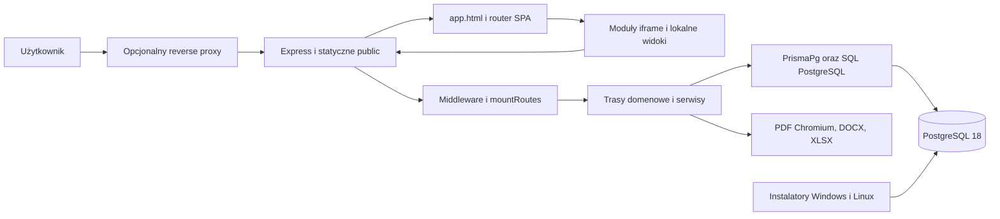
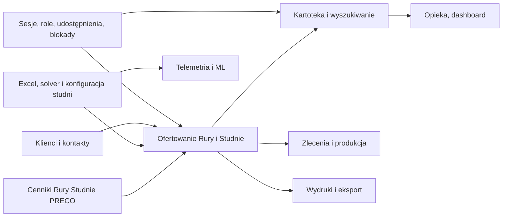
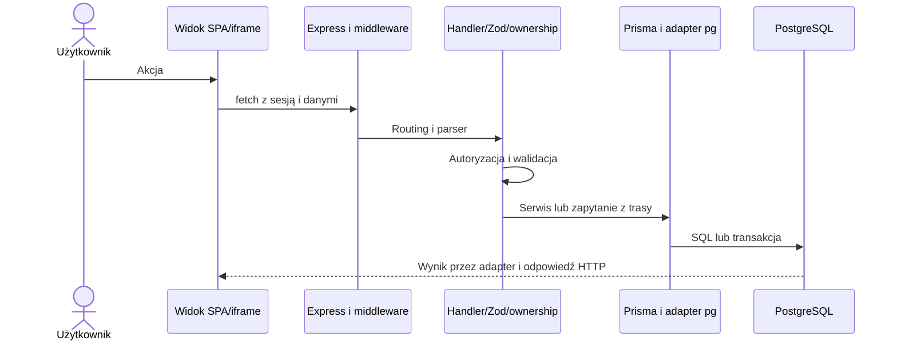
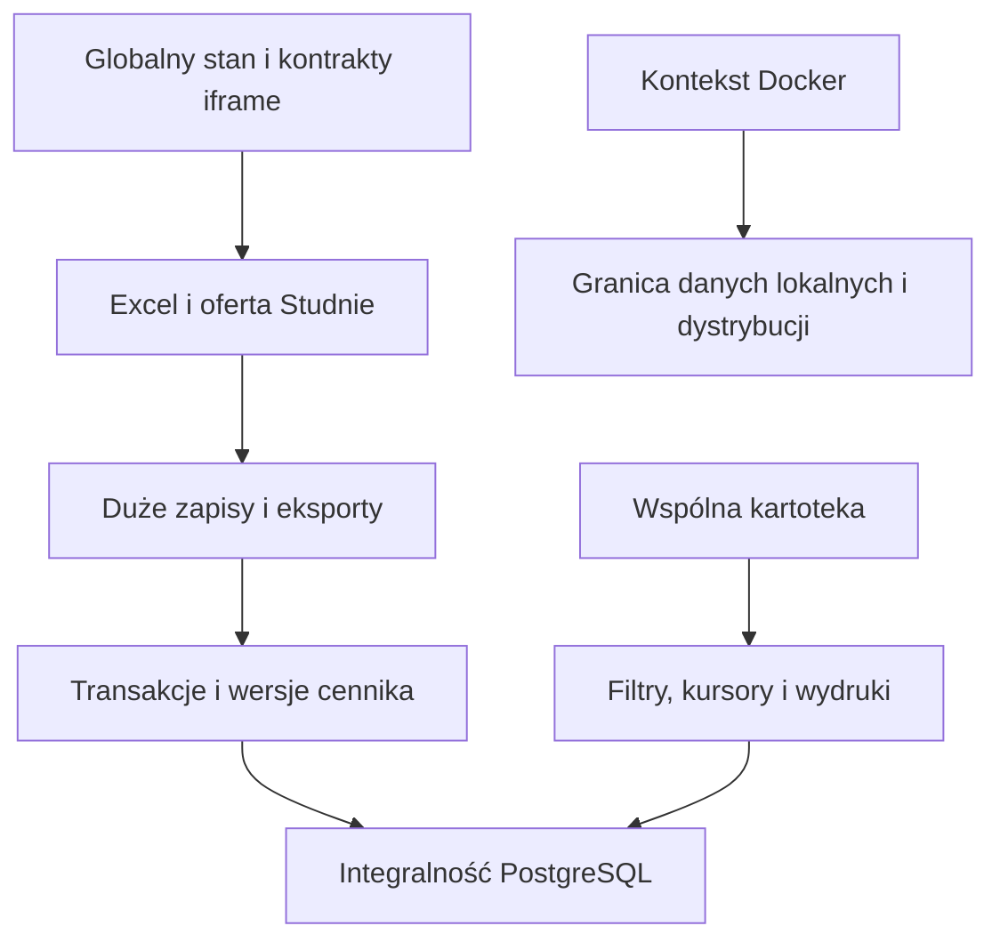

# Architektura S.O.K.

## A0 · Stan lokalny

- Katalog I:/GitHub/Oferty_PV, branch main, HEAD e6cf731ed65b8399cebb891c0375139003d6e3a6, wersja aplikacji 1.56.4. Przed audytem istniały zmiany porządkowe Hermes oraz niezapisany w Git przeniesiony plan archiwalny. Historia 15 ostatnich commitów zawiera poprawki sortowania PG, Chromium, filtra wydruku, CI, bootstrapu cenników i dokumentacji.
- Inwentaryzacja Git obejmuje 1669 ścieżek. Poniższe linie fizyczne obejmują także komentarze, białe linie, aktywa vendored oraz fixture. Rozszerzenia liczone to TS, JS, CJS, MJS, CSS, HTML, Prisma, SQL, PowerShell, sh, bat. Markdown, JSON i YAML są w liczbie plików, poza LOC.

| Obszar                  | Pliki Git | Pliki wg rozszerzeń |   Linie |
| ----------------------- | --------: | ------------------: | ------: |
| src                     |       208 |                 208 |  44 755 |
| public                  |       332 |                 314 | 177 949 |
| prisma                  |         6 |                   5 |   2 383 |
| scripts                 |        88 |                  84 |  16 240 |
| tests                   |       640 |                 637 | 123 891 |
| docs                    |       278 |                   — |       — |
| .github                 |        13 |                   — |       — |
| root                    |        53 |                  24 |   1 876 |
| Suma policzonych źródeł |         — |               1 272 | 367 094 |

- TypeScript 6.0.3, Express 4.22.3, Zod 4.6.7, Prisma CLI/client/adapter-pg 7.10.1, pg 8.23.1, Helmet 8.3.0, Puppeteer 25.16.0, DOCX 9.14.0, Jest 30.4.2, Playwright 1.64.1. Wersje z lokalnego lockfile, podstawowe zależności PG oraz TS dodatkowo z node_modules.
- Wstępna mapa z lokalnego Graphify (11 308 węzłów, wynik ograniczony budżetem) potwierdzona w src/mountRoutes.ts, src/app.ts, server.ts, public/js/spa/router.js oraz prisma.config.ts. Graf ma charakter pomocniczy.
- Punkt wejścia serwera to server.ts:54–86. Express montuje middleware i statyczne public/ w src/app.ts:257–272,346–382, trasy w src/mountRoutes.ts:78–148. Init uruchamia weryfikację DB i bazowych cenników w src/app.ts:397–427. Jest to monolit z zależnościami Express → serwisy/bezpośredni Prisma. Granica route → service jest niejednolita, zwłaszcza w CRUD ofert i klientów.

## A1 · Architektura całej aplikacji

## Zależności modułów

## Przepływ zapytania

## Punkty sprzężenia i ryzyka

Statyczny skan deklaracji import/export i literalnych require/import, rozwiązywanych względnie po typowych rozszerzeniach i index, nie znalazł cykli w src/public. Zakres nie obejmuje kolejności klasycznych skryptów, window, iframe, aliasów, dynamicznych importów ani pośrednich zależności biznesowych. Te ścieżki pozostają istotne pomimo braku cyklu w tym podgrafie. Frontend ma osobne bramki kolizji oraz ratchet importów.
