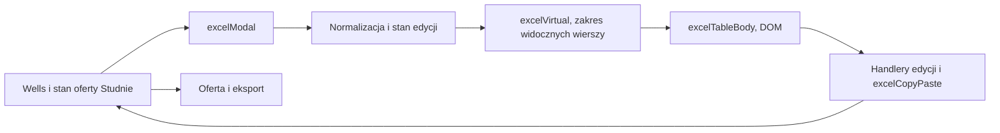

# Frontend, UX i dostępność

## A2 · Granice i inicjalizacja

- public/app.html:206–226 ładuje mieszane defer i ESM. Router public/js/spa/router.js:567–613 tworzy i pamięta iframe, a :757–766 przełącza widoki przez CSS. Router strzeże tras, ma osobny mechanizm dirty-navigation i przywracania ostatniej trasy. Współdzielony stan window, globalne handlery i zależność od kolejności skryptów są częścią kontraktu legacy.
- Zalety widoczne w kodzie to warstwa auth, wspólne modalCore, toast, escapeHtml, fetchJson, wsparcie obsługi błędów sieci i wybierania daty. Statyczne źródła nie wystarczają do oceny finalnego układu, kontrastu, skali mobilnej ani komunikatów podczas awarii.
- FE-01 P1: druk łączny pobiera po jednym zestawie maksymalnie 100 ofert i nie przechodzi kolejnych stron. Pole szukania korzysta z już załadowanej listy. Źródło public/js/shared/printModal.js:241–267,288–299,334–345.
- FE-04 P1: druk łączny wysyła gołe daty YYYY-MM-DD, a backend używa interpretacji timestamptz i końca dnia w UTC. Kartoteka normalizuje półotwarte granice lokalnego dnia do ISO. W strefie Warszawy wyniki mogą różnić się na granicach dnia i DST. Źródło printModal.js:250–267, src/utils/searchUtils.ts:207–220, public/js/kartoteka/kartotekaFilter.js:168–187.
- FE-02 P2: abort starszego wyszukiwania może zwolnić wspólne isLoading, gdy następne nadal trwa, co osłabia ochronę loadMore. Źródło public/js/kartoteka/kartotekaSearch.js:116–126,204–222.
- FE-03 P2, wniosek: utrzymany iframe nie ma wyraźnego protokołu suspend dla wszystkich timerów. Zlecenia posiadają interwał z guardem document.hidden i zaznaczenia. Potrzebny trace ruchu przy zmianie modułów. Źródło router.js:567–613,757–766, public/js/spa/zlecenia.js:331,359–372.
- FE-06 P2: renderowane kontrolki w wierszach Excela mają zbyt mało kontekstu w dostępnej nazwie. Same nagłówki tabeli nie zastępują kontekstowej nazwy kontrolki. Potwierdzenie praktyczne wymaga NVDA i testu obsługi klawiaturą. Źródło public/js/studnie/excelTableBody.js:331–339,375–407.
- FE-05 P2: scenariusz axe dla Kartoteki przechodzi na chronioną trasę bez przygotowania sesji i potrafi przeanalizować stronę zastępczą zamiast iframe. Źródło tests/playwright/a11yAxe.spec.ts:96–106,141–149, public/js/spa/router.js:895. Jest to luka w dowodzie, a nie dowód braku zgodności każdego widoku.

- FE-09 P2: lista opiekunów filtra zależy od danych pierwszej strony, a loadMore nie uzupełnia jej na tej ścieżce. Użytkownik nieobecny na pierwszych 50 wynikach może wypaść z filtra. kartotekaFilter.js:190–215, kartotekaSearch.js:143,171–190.
- FE-10 P2: partialLoader wymusza Date.now w URL, przechwytuje odrzucone fetch przed allSettled, a następnie emituje partials:loaded. Brak wymaganego fragmentu może dać pusty widok z błędem tylko w konsoli. public/js/shared/partialLoader.js:2–31, rury.html:104–124, studnie.html:259–306.

## Excel · ścieżka renderowania

Excel domyślnie wirtualizuje wiersze i łączy scroll z rAF. Kodu nie należy dzielić według rozmiaru bez zachowania zachowania tabeli. Konkretny defekt FE-07 w modalu opisuje raport biznesowy. Benchmarki i niezweryfikowane elementy opisuje 07_PERFORMANCE.md.

Oceny cząstkowe z dowodami i granicami w 13_FINAL_SCORECARD.md. Przegląd klawiatury, focus, kontrastu, responsywności i czytnika ekranu w aktualnej uruchomionej aplikacji pozostaje N/A.
