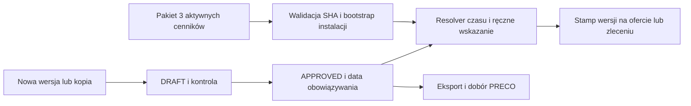

# PostgreSQL i Prisma

## A4 · Stan potwierdzony lokalnie

Prisma wskazuje provider postgresql (prisma/schema.prisma:11–12) i wyłącznie migrations-postgresql (prisma.config.ts:4–11). Trzy migracje tworzą schemat i indeksy, aktualizują projekcję latest_followup przez trigger oraz dodają częściowe ograniczenia unikalności. Docker wskazuje PostgreSQL 18 Alpine (docker-compose.yml:3), Prisma CLI/client/adapter-pg 7.10.1 oraz pg 8.23.1 są zgodne wersjami lokalnie z lockfile. src/prismaClient.ts:10–35 wymaga URL PostgreSQL, ustawia max 10, timeout połączenia 10 s, bezczynności 30 s i osobny search_path. Brak dowodu bieżącej instalacji 18.x lub zgodności wszystkich scenariuszy z PG 18 na docelowym hoście. Odnotowane historyczne uruchomienia opisują docs/agents/testing.md i docs/DEPLOYMENT.md.

Statyczny guard objął 309 plików i zakończył się sukcesem. Pokrywa wybrane wyrażenia SQLite i ścieżki, więc jest uzupełnieniem, a nie dowodem wszystkich przypadków. Nazwy historyczne jak fts5Queue nadal istnieją (src/utils/fts5Queue.ts), lecz wybór SQL w tym pliku korzysta z tabel PostgreSQL. Zmiana nazwy ma niższy priorytet od integralności i planów zapytań.

## Schemat i zapytania

- Oferty rur/studni mają unikalne numery i indeksy użytkownik/czas/id (prisma/schema.prisma:312–380). Migracja 0001:1182–1213 zabezpiecza wybrane relacje FK oraz GIN po tsvector dla obu ofert. 0002:2–72 utrzymuje latest_followup; 0003 wprowadza dodatkowe inwarianty. Część dat i dokumentów nadal jest TEXT, a dane wersji stanowią kombinację relacyjnych pozycji i metadanych.
- DB-01: sortowanie po offer_number oraz kursor po createdAt/id naruszają ten sam porządek stronicowania (src/utils/searchUtils.ts:101–107,149–155, src/routes/offers/search.ts:269–277).
- DB-04: passthrough payloadu i parseLegacyDate mogą dopuścić niepoprawną tekstową datę, która potem trafia do rzutowania na timestamptz i wywołuje 500 w wyszukiwaniu. Również parametr kursora przyjmuje tekst bez wystarczającej walidacji. src/validators/offerSchemas.ts:82–98,153–184, src/helpers.ts:75–83, src/routes/offers/studnieCrud.ts:835,888, src/utils/searchUtils.ts:90–91,134–155,206–231.
- DB-02: odwołania ofert/zleceń do wersji cen są nullable, indeksowane, bez FK. Usuwanie w lifecycle najpierw sprawdza użycie, a część zapisów pobiera aktywną wersję przed transakcją. Możliwe osierocenie w wyścigu, szczególnie między procesami. prisma/schema.prisma:332,367,489,507, src/services/pricelist/lifecycle.ts:953–990, src/routes/offers/ruryCrud.ts:166,474, src/routes/offers/studnieCrud.ts:539,929, src/services/pricelist/validation.ts:124–133.
- DB-03: normalizacja dat, wyszukiwanie i połączenia z projekcją mają potencjalny koszt. Istniejące indeksy nie dowodzą ich użycia na każdym wariancie filtrów. EXPLAIN ANALYZE, kardynalności, rozmiary, deadlocki, bloat, pooling wielu instancji, lock wait i produkcyjna konfiguracja pozostają N/A.

## Wersje i aktywacja cen

APPROVED jest statusem wersji, obowiązywanie wynika z resolvera i nadpisania. Kopia oznaczona do instalacji to Rury, Studnie i PRECO, 1023 pozycji. Test zweryfikował sumę i strukturę, nie wykonał zapisu. Kontrakt zachowania wyłącznie aktywnych cenników nie oznacza zachowania historycznych zależności PRECO. BUS-03 wskazuje, że powtórny eksport tej samej wersji może zależeć od późniejszej publikacji z datą wsteczną (src/services/pricelist/export.ts:664–682,719–740).

Backup posiada odrębne role i archiwum pg_dump, SHA-256, pg_restore --list oraz retencję po walidacji (scripts/backup.ts:269–391). Odczyt TOC nie dowodzi odtwarzalności. Restore do izolowanego celu, odczyt po odtworzeniu i docelowe RPO/RTO wymagają osobnego przebiegu.

## Dodatkowe kontrole operacyjne

- 47 modeli, 3 enumy i 6 FK w bazowej migracji. Brak FK dla części istniejących relacji jest istotny przy imporcie i zleceniach. Pakiet APPROVED wskazuje sekwencje Rury 4, Studnie 6, PRECO 2.
- DB-05: restore najpierw modyfikuje cel w transakcji pg_restore, po czym osobno uruchamia migracje/granty. Awaria drugiej fazy pozostawia zmienioną bazę z ogólnym komunikatem. scripts/restore-db.js:156–165,315–328.
- DB-06: role rozdzielono, ale sok_app otrzymuje CRUD do wszystkich aktualnych i przyszłych tabel w public, w tym metadanych migracji, jeśli są w tym schemacie. scripts/grant-postgres-roles.mjs:9–26. Przegląd uprawnień po instalacji N/A.
- DB-07: /health/ready potwierdza SELECT 1, a nie dostępność schematu lub cennika (src/app.ts:150–161). Rozróżnić probe żywotności DB od smoke aplikacji. Transakcje gorących ścieżek mają maxWait 15 s/timeout 30 s (src/utils/hotTx.ts:7), nie jest to pomiar czasu zapytań.
