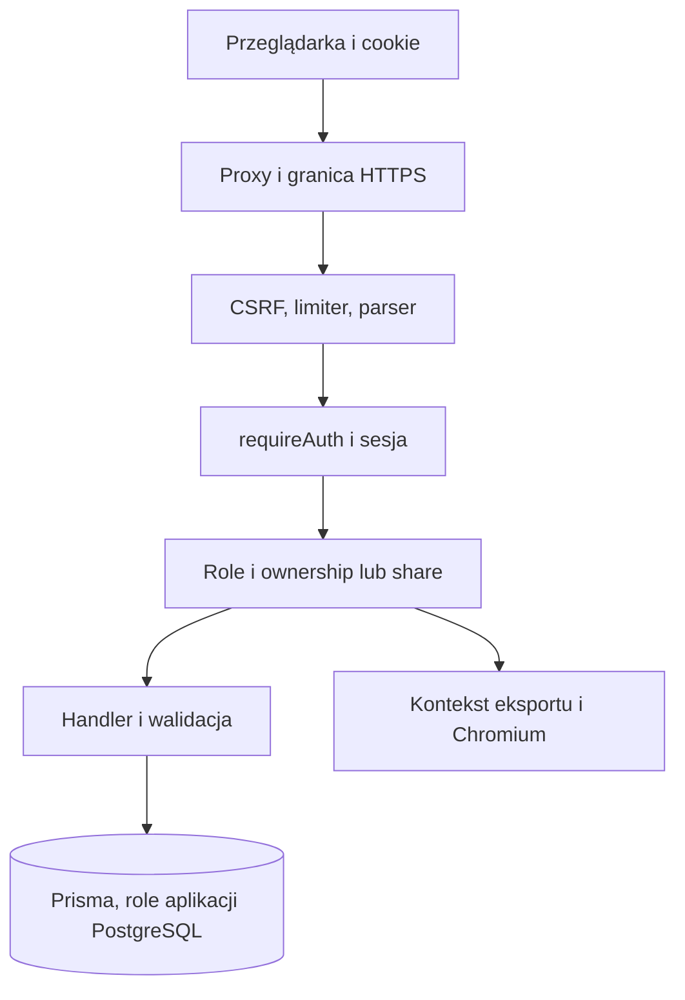

# Bezpieczeństwo

## A6 · Model i zakres

Kod zawiera httpOnly/SameSite cookie, autoryzację owner/share/admin, Helmet, CSP, limiter i oddzielne role DB. Chroniony eksport łączny ponownie weryfikuje uprawnienia w kontekście aktualnych wierszy (src/routes/exportCombined.ts:88,137, src/services/pdf/context.ts:61–75,235–247). Dwa rawUnsafe w app.ts:152,404 to stałe SELECT 1. Trzecie w fts5Queue.ts:124–129 wybiera tabelę z dwóch stałych, a wartość ID przekazuje jako parametr. Brak podstaw do zgłoszenia SQL injection w tych trzech miejscach. Nie przeprowadzono testu penetracyjnego, skanu CVE ani sprawdzenia ważności wartości przypominających sekrety.

| ID / waga                       | Dowód i wpływ                                                                                                                                                                                                                                                                                                                                |
| ------------------------------- | -------------------------------------------------------------------------------------------------------------------------------------------------------------------------------------------------------------------------------------------------------------------------------------------------------------------------------------------- |
| SEC-01 HIGH                     | Odczytowe share wystarcza do acquire i heartbeat, a owner potrzebuje blokady do zapisu. Użytkownik może utrzymywać cudzą blokadę. src/routes/locks.ts:33–47,57–83, src/utils/docLocks.ts:15, src/routes/offers/ruryCrud.ts:873, studnieCrud.ts:1302.                                                                                         |
| BUS-01 HIGH                     | Brak weryfikacji uprawnień do oferty przy podpinaniu własnego zlecenia. Powiązanie wpływa na cudze liczniki/usuwanie. src/routes/orders/ruryOrders.crud.ts:221–238,261–279, studnieOrders.crud.ts:232–247,312–327, src/utils/orderStamp.ts:27–37.                                                                                            |
| SEC-02 MEDIUM                   | ACL zmienione przez users nie unieważnia wyników cache wyszukiwania; istnieje okno do TTL 30 s. src/routes/offers/search.ts:31–43,298, src/routes/orders/production.ts:193–204, src/routes/users.ts:130–163, src/utils/searchCache.ts:41.                                                                                                    |
| SEC-03 MEDIUM                   | Log requestu zawiera pełne originalUrl, a q w Kartotece może zawierać NIP albo klienta. src/middleware/requestLogger.ts:27, public/js/kartoteka/kartotekaSearch.js:76,134–152.                                                                                                                                                               |
| SEC-04 LOW                      | Porównanie host zamiast pełnego origin pomija protokół; wpływ zależy od cookies i topologii. src/middleware/csrf.ts:32–48.                                                                                                                                                                                                                   |
| SEC-05 MEDIUM, warunkowe        | HTTPS redirect ręcznie czyta X-Forwarded-Proto bez granicy zaufania Express. Przy bezpośrednim HTTP i TRUST_PROXY=0 zachowanie Secure może się rozjechać. src/middleware/security.ts:66–70, src/routes/auth.ts:28–31, docker-compose.yml:35 ogranicza mapowanie do loopback.                                                                 |
| SEC-06 HIGH, ryzyko dystrybucji | COPY . . w Dockerfile:34, .dockerignore pomija część .env i dane, ale nie wyłącza w całości lokalnych .claude, .codex, .agents ani graphify-out. W tym checkout te foldery istnieją. Możliwa publikacja niezamierzonych danych w obrazie. Zawartości prywatnych ustawień, faktycznej publikacji i obecności ważnych sekretów nie sprawdzano. |
| SEC-07 HIGH, warunkowe          | Limity 128/50 MiB stosowane przed auth na poziomie montowania i kontrola per request, bez dowodu globalnego limitu pamięci. src/mountRoutes.ts:54–109. Seria dużych żądań może zwiększyć RSS i obciążenie parsera.                                                                                                                           |
| SEC-08 MEDIUM, warunkowe        | Chromium uruchamiany z --no-sandbox (src/services/pdf/pdfEngine.ts:152–168), komentarz o root nie odpowiada USER node w Dockerfile:64. JS w PDF jest wyłączony. Wymaga testu egress i polityki izolacji na docelowym hoście.                                                                                                                 |

Brak potwierdzonego P0 bezpieczeństwa w zbadanych ścieżkach. API-01 jest odrębną blokadą P0 integralności. Próby w pamięci potwierdziły akceptację obu protokołów przez sprawdzanie hosta i obejście redirect po podaniu X-Forwarded-Proto w syntetycznym req.secure=false. Sprawdzono też równoważność haseł bcrypt po wspólnych pierwszych 72 bajtach ASCII (SEC-09, LOW, src/validators/authSchema.ts:15–22 i src/routes/auth.ts:121,220). Przed wdrożeniem wymagane są regresje kontroli dostępu, sprawdzenie zawartości obrazu ze sztucznymi plikami markerów i dowód zachowania TLS w docelowej topologii. CORS, XSS, upload, CSRF, rate limiting i role mają statyczny przegląd reprezentatywnych granic, bez pełnego pokrycia każdej kombinacji roli i endpointu.
