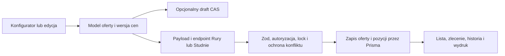

# Moduły biznesowe

## A7 · Mapa obszarów i oceny statyczne

Wyniki są ocenami projektu i przeglądanych ścieżek, bez potwierdzenia pełnego przepływu na działającym środowisku. Wagi 30/20/20/15/15 opisano w 13_FINAL_SCORECARD.md. Dla ocen cząstkowych w tabeli liczby w nawiasie odpowiadają kolejno poprawności, odporności, utrzymaniu, projektowi wydajności i testowalności.

| Moduł                                            | Ocena i dowody                                                                                                                                             | Do poziomu 9                                                                          |
| ------------------------------------------------ | ---------------------------------------------------------------------------------------------------------------------------------------------------------- | ------------------------------------------------------------------------------------- |
| Rury                                             | 6,95 (7/6/7/7/8), ruryCrud.ts, offerSchemas.ts, transferJson.js. Walidacja, transakcje i stamp; częściowy import BUS-04.                                   | Pełny kontrakt importu, dwa równoległe zapisy, porównanie ceny i wydruków.            |
| Studnie, solver, konfigurator                    | 6,68 (7/6/6/7/7.5), studnieCrud.ts, solverAutoSelect.js, excelModal.js. Solver i ścieżki eksportowe są wydzielone; FE-07 i BUS-04.                         | Utrwalenie anulowania, regresje solvera na dużym modelu i cen z historycznego źródła. |
| Excel S.O.K.                                     | 6,68 (6/6/6/8/8.5), excelVirtual.js, excelCopyPaste.js, excelTableBody.js. Wirtualizacja i testy golden/parity, niespójna semantyka zamknięcia i etykiety. | Regresje 100/101/1000/5000/10 000, klawiatura, budżety heap i p95 na profilu 4 GB.    |
| Rury/Studnie/PRECO/transport i menedżer cenników | 7,15 (7/7/7/7/8), pricelistVersions.ts, lifecycle.ts, export.ts. SHA bootstrapu i approval; historyczny wybór PRECO, brak FK stamp.                        | Atomowa publikacja i pin zależności, świeża instalacja oraz smoke import/export.      |
| Kartoteka, filtry i historia                     | 6,40 (6/6/6.5/7/7), search.ts, searchUtils.ts, kartotekaSearch.js, audit.ts. Indeksy i paginacja, lecz DB-01/04, API-04, FE-02/09.                         | Semantyka cursor i dat wspólna dla sortów, autoryzacji i eksportów.                   |
| Zlecenia i produkcja                             | 6,40 (6/5.5/7/7/7), ruryOrders.crud.ts, studnieOrders.crud.ts, production.ts. Liczniki i transakcje; BUS-01/02.                                            | ACL relacji, kontrola powiązań, historia po commit, współbieżność liczników.          |
| Klienci i kontakty                               | 5,43 (4/5/6/6/7.5), clients/index.ts i clientManager.js. Zapis atomowy serwera, ale P0 zastępowania starszą kopią.                                         | Rewizja/409 i explicit delete, regresje dwóch sesji oraz par klient/kontakt.          |
| Wydruki, import i eksport                        | 6,00 (5.5/6/6/6/7), exportCombined.ts, pdfEngine.ts, printModal.js, transferJson.js. ACL obu ofert i kolejka PDF; niekompletny wybór i raport importu.     | Test PDF/DOCX/XLSX z rzeczywistym rendererem, daty, paginacja, atomowość.             |
| Draft, blokady i udostępnienia                   | 6,30 (6/5/7/7/7), drafts.ts, draftService.ts, shares.ts i locks.ts. CAS i TTL; BUS-05/SEC-01/API-02.                                                       | Regresje równoległości i matryca ról, prawdziwa ochrona przed nadpisaniem.            |
| Pulpit, opieka i raporty                         | 7,05 (7/7/6.5/7/8), care.ts, careService.ts, dashboard.js i migracja 0002. Projekcja latest_followup i testy cykli.                                        | Test dostępu i obciążenia dashboardu, spójność raportu po równoległych zmianach.      |
| Użytkownicy, administracja i konfiguracja        | 6,88 (7/6/7/7/7.5), users.ts, auth.ts, settings.ts, admin.ts, featureFlags.ts. Role i invalidacja sesji, cache wyszukiwania ma osobne życie.               | Scenariusze odebrania dostępu, TLS i redakcja logów.                                  |
| Telemetria, AI/ML i transfer                     | 6,63 (6.5/6/6.5/7/7.5), telemetryAiMl.ts, TrainingPipeline.ts, transfer/dataset.ts i compatibility.ts. Lineage i paczka walidowana; BUS-06.                | Rozdzielenie fingerprint lineage i treści, dowody kompatybilności oraz modelu.        |

Zaokrąglenia tabeli są opisowe. Werdykt makro modułów nie jest średnią liczby ekranów. Odzwierciedla ryzyko krytycznych przepływów i wspólnych granic.

## Tworzenie i zapis

- FE-07 P1. Modal powyżej 100 studni pomija snapshot. Przycisk „Zamknij bez zapisu” ostrzega i zamyka, ale edycje pozostają w modelu. Mogą wejść do późniejszego zapisu. public/js/studnie/excelModal.js:202–209,584–625. Parity cjs:650 nie dowodzi przywrócenia stanu.
- BUS-01 P1. Zlecenie przyjmuje ID obcej oferty bez ACL do źródła, przez co można zmienić relację i zablokować usunięcie oferty innego właściciela. orderStamp.ts:27–37, orders CRUD i offers/crud.ts:273–282.
- BUS-02 P1. Ścieżka Studnie zapisuje audyt usunięcia przed kontrolą powiązań i transakcją. Odrzucona operacja może wyglądać jak wykonana. src/routes/offers/studnieCrud.ts:1366–1400. Ścieżka alternatywna robi audyt w transakcji (offers/crud.ts:182–209). CRUD zleceń również inicjuje audyt przed CAS/lockiem.
- BUS-03 P2. Historyczny eksport Studnie wybiera PRECO dynamicznie. Publikacja wsteczna zmienia potencjalny wynik tej samej wersji. src/services/pricelist/export.ts:664–682,719–740 oraz lifecycle.ts:502–549.
- BUS-04 P1. Import JSON zapisuje ofertę, po czym nie sprawdza response.ok dla zapisów zleceń. Późniejszy spread order.data potrafi nadpisać identyfikator importowanej oferty. public/js/import-export/studnie/transferJson.js:75–125, rury/transferJson.js:96–146.
- BUS-05 P1, wniosek. Odczyt wygasłego draftu usuwa po PK bez predykatu wersji. Równoległy PUT z CAS może przed DELETE odświeżyć i zapisać draft. src/services/drafts/draftService.ts:96–110,191–201.
- BUS-06 P2. Fingerprint datasetu opiera się na metadanych rekordów, nie pełnych wartościach cech, podczas gdy komunikat transferu mówi IDENTICAL. src/services/ml/TrainingPipeline.ts:102–107, src/services/ml/transfer/dataset.ts:82–89 i compatibility.ts:86–90.

Przebiegi zapisu ofert, zatwierdzenia cenników, renderowania dokumentów, telemetrii i transferu ML na lokalnej instancji pozostają N/A.
